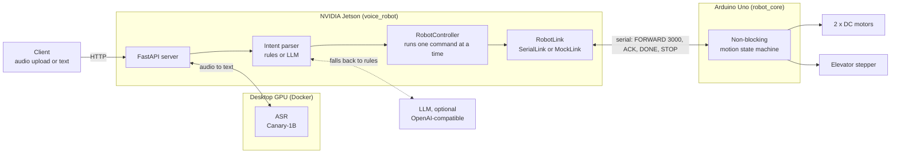

# Voice-Controlled Robot

<div align="center">

[](https://github.com/yongjer/university-project/actions/workflows/ci.yml)
[](https://deepwiki.com/yongjer/university-project)

</div>

A differential-drive robot with a stepper-driven elevator that follows spoken
instructions such as *"move forward 3 seconds then turn right 2 seconds"*. It connects
speech recognition on a desktop GPU, a controller on an NVIDIA Jetson, and an Arduino
Uno that drives the motors. Recognition runs on the desktop because the Jetson does not
have enough compute for these models.

This began as a 2023-2024 university team project. The original prototype is preserved at the tag
[`v1.0-legacy`](https://github.com/yongjer/university-project/tree/v1.0-legacy); this
version re-engineers it with a non-blocking firmware, a tested API, and hardware-free CI.

## Architecture



| Directory | Contents |
| :--- | :--- |
| [`arduino/`](arduino/README.md) | C++ firmware, wire protocol, native unit tests |
| [`jetson/`](jetson/README.md) | Python package: API, intent parsing, execution, CLI |
| [`ai_server/`](ai_server/compose.yaml) | Docker Compose profiles for the AI models |

## From v1 to v2

| Area | v1 prototype | v2 |
| :--- | :--- | :--- |
| Firmware loop | `readStringUntil()` and `delay()` block the loop, so `STOP` is ignored during a motion | Non-blocking `LineBuffer` and `millis()` state machine; `STOP` and new commands take effect during a motion |
| Elevator | `runSpeed()` was called once before `delay()`, so each command produced at most one step | Pulses generated on every loop pass |
| Build | Undefined `MOTOR_INTERFACE_TYPE` macro, did not compile as committed | Builds for the Uno in CI |
| Intent parsing | Two embedding calls per utterance; one action only; unrelated speech still picked an action | Multi-step sentences; unrelated speech moves nothing; rules by default, optional LLM with JSON schema and automatic fallback |
| Execution | Fire-and-forget serial write, no confirmation | Waits for `ACK` and `DONE`; a lost reply triggers a safety `STOP` and fails the plan |
| Testing | Needed the robot and `/dev/ttyUSB0` | `MockLink` firmware emulator; 18 firmware tests and a `pytest` suite run in CI without hardware |
| Interface | Gradio demo page | HTTP API (`/health`, `/command/text`, `/command/audio`, `/stop`) and CLI |
| Repository | Temp recordings, `.DS_Store`, broken submodule, one `run.sh` per model | Cleaned up; `uv` and `pyproject.toml`; single `compose.yaml`; CI |

## Quick start

No robot is needed: the default configuration runs against an in-process firmware
emulator. Requires [uv](https://docs.astral.sh/uv/).

```bash
cd jetson
uv sync
uv run voice-robot run "move forward 2 seconds then turn right for half a second"
uv run voice-robot serve   # API docs at http://localhost:8000/docs
```

Run the tests:

```bash
(cd jetson && uv run pytest && uv run ruff check .)
(cd arduino && pio test -e native && pio run -e uno)   # uv tool install platformio
```

## Running on the robot

1. Flash the firmware: `cd arduino && pio run -e uno -t upload`
2. Start speech recognition on the GPU server: `cd ai_server && docker compose --profile canary up`
3. On the Jetson:

   ```bash
   cd jetson
   uv sync --extra asr
   ROBOT_LINK=serial ROBOT_SERIAL_PORT=/dev/ttyUSB0 \
   ROBOT_ASR_URL=http://<gpu-server>:7860 uv run voice-robot serve
   ```

4. Send a recording, and keep the stop command at hand:

   ```bash
   curl -F file=@command.wav http://<jetson>:8000/command/audio
   curl -X POST http://<jetson>:8000/stop
   ```

The API has no authentication; see [`jetson/README.md`](jetson/README.md#http-api).

## Verification status

Everything above runs in CI without hardware, using host-side firmware tests, an AVR
build, and `pytest` against the firmware emulator and a simulated serial port. The v2
firmware has not yet been run on the physical robot, and the original ASR containers have
not been exercised end to end with v2. Motor direction and stepper settings may need
adjusting on the bench (see [build options](arduino/README.md#build-options)).

## Team and AI disclosure

- **Team:** Yong-Jer Chuang was responsible for all software, including the firmware.
  Teammates built the hardware.
- **v1 (2023-2024, tag `v1.0-legacy`):** Written by Yong-Jer Chuang without AI coding
  agents, with some help from AI chat or autocomplete tools. The 2025 README was written
  by the Jules bot (`ae32c50`).
- **v2 (2026):** The implementation and documentation were largely generated by AI coding
  agents (Google Antigravity and Claude Code) under Yong-Jer Chuang's direction, who set
  the requirements and constraints. Results are checked by the automated tests and CI
  described above.
- **Reading the history:** A `Co-Authored-By` trailer names only the tool that made that
  commit. The firmware in `33f2814` was written with Antigravity and committed with Claude
  Code, and the cleanup commit `bead8a6` was also AI-assisted but has no trailer.

## License

[GPL-3.0](LICENSE)
